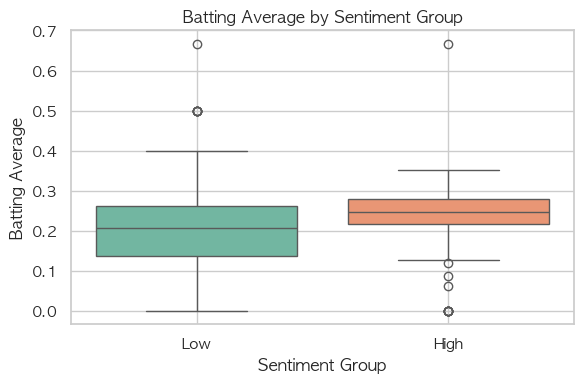
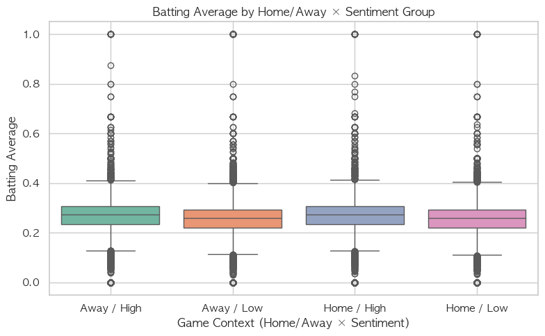
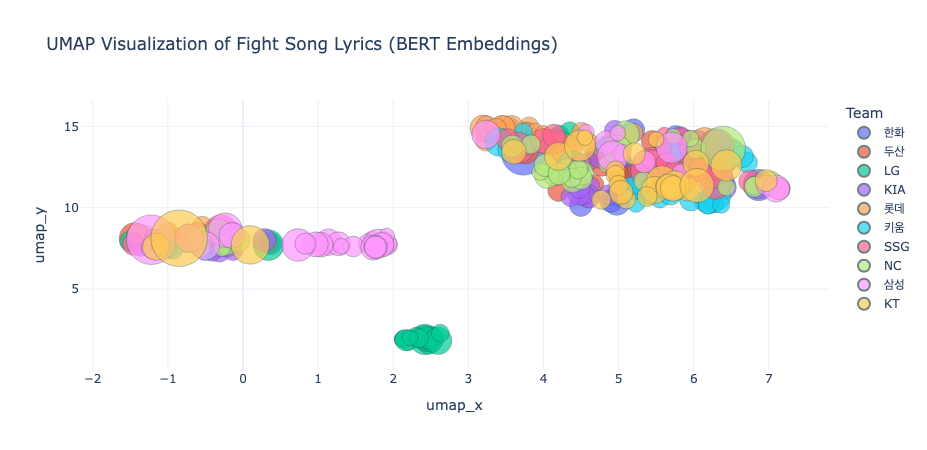

# KBO 應援歌歌詞與打者表現

[English](README.md) | [繁體中文](README.zh-TW.md)

Meng-Yu Chiu · KAIST HSS510 · 2025 年春季

<b>KBO 應援歌歌詞，和打者表現有關嗎？</b>

這是我在 KAIST HSS510「NLP for Humanities and Social Sciences」課程完成的個人研究。我把 2022–2024 年<b>超過 54,000 筆球員出賽紀錄</b>，連結到手動整理的應援歌資料，設計符合棒球應援情境的歌詞分數，再檢查它與打擊率的關聯。

研究的重點包括如何把歌詞轉成可解釋的變數、如何選擇分析單位，以及統計結果能支持什麼程度的結論。

[Notion：中英文作品集](https://app.notion.com/p/258fea401f5a8004a222c5d5bb58a2c6)

## 1. 研究動機與問題

KBO 的個人應援歌會反覆呼喊球員姓名、球隊名稱與打擊用語。我好奇的是：<b>把歌詞本身當成可測量的資料，能否觀察到它與打者表現的關聯？</b>

文獻回顧中，應援歌常被放在球迷文化與隊伍認同的脈絡討論；觀眾與運動表現的研究則多關注人數或主客場。我想將問題往歌詞內容推進，檢查自訂歌詞分數與打擊率的關係，以及主場、觀眾人數或歌曲共用方式，是否改變這個關係。球隊用語與打順則作為補充探索。

這份研究使用觀察資料，目標是找出值得繼續檢查的關聯；歌曲並未隨機分派給球員，因此無法直接驗證換歌是否會改善表現。

## 2. 我的角色與負責範圍

這是個人課程研究。我負責研究問題與假設設計、比賽資料蒐集與清理、個人應援歌的手動整理、歌曲再使用與承襲的編碼、自訂分數設計、統計分析、圖表與論文撰寫。

我需要決定哪些應援用語要納入分數、歌曲使用方式如何分類，以及每個問題應使用逐場資料或彙總資料。Claude Code 協助程式實作；研究定義、人工資料判讀與結果解釋由我負責。

## 3. 資料與分析單位

| 資料 | 來源與內容 | 整理方式與用途 |
| --- | --- | --- |
| 比賽情境 | KBO 網站的 2022–2024 年賽程、球場、觀眾人數與比賽結果 | 以 gameId 對齊逐場資料，排除沒有打者表現資訊的因雨取消比賽 |
| 打者紀錄 | 透過 KBO 比賽資料介面，依 gameId 取得打數、安打、打點、得分、打擊率、打順與守備位置 | 整合後每列是一位球員在一場比賽的出賽紀錄；同一球員會出現多次 |
| 應援歌 | 手動整理個人應援歌歌詞、原曲資訊，以及再使用、承襲與共用人數 | 依球員與球隊連結至出賽資料；沒有個人應援歌時實際播放的團歌，未完整納入 |

<b>54,000 多筆是出賽紀錄數，不是獨立球員或歌曲的數量。</b>主要的分數與打擊率相關分析，先將三個球季資料彙整為「球員 × 球隊」：同一球員在不同球隊的紀錄分開計算，打擊率以該組總安打除以總打數取得。其他假設另依問題使用逐場或球員層級資料。

歌曲使用方式也需要明確區分：<b>再使用</b>指沿用旋律、較大幅度改寫歌詞；<b>承襲</b>指大致保留歌詞、主要更換球員姓名；共用人數則記錄同首歌被多少球員使用。

## 4. 方法、工具與產出

| 步驟 | 工具 | 產出與判斷 |
| --- | --- | --- |
| 整合資料 | Python、Selenium、BeautifulSoup、requests、pandas | 將賽程、觀眾與打者紀錄對齊，再連結手動整理的歌曲資訊 |
| 將歌詞量化 | Kiwi、自訂應援詞典與呼喊情境規則 | 產生歌詞分數，保留棒球用語與呼喊形式的特徵 |
| 檢查假設 | scipy、statsmodels | 相關分析、迴歸、交互作用與分組檢定，依問題選擇分析粒度 |
| 補充文字探索 | 詞性分析、KLUE BERT、sentence-transformers、K-means、PCA、UMAP | 描述球隊用語與歌詞語意；用於探索，不作為球隊表現排名 |

我把自訂指標稱為<b>歌詞情緒分數</b>。例如，球隊名稱給 1 分，安打、全壘打與部分動作用語給 2 分；若出現在括號、特定標點或呼喊型態附近，則將符合條件的片段加倍，最後對有得分的片段取平均。

這個分數衡量的是詞典與加權規則下的應援語言特徵，並非直接測量球員的實際情緒。重複母音與呼喊形式是情境線索，不能簡單視為一般文本中的雜訊。

<details>
<summary>程式與重現說明</summary>

公開 repository 包含研究 notebook、少量資料摘要與部分圖表，沒有完整的逐場模型輸入與人工歌詞資料。因此，只執行爬蟲或使用 data 資料夾中的小型 CSV，無法直接重現整份分析。

使用前需調整 Chrome／chromedriver、檔案路徑與輸入資料，並先完成歌曲資訊整理，再產生 with\_sentiment\_boost\_rounded.csv 與 player\_team\_summary.csv 等中間檔。Notebook 保留了研究過程的不同版本與探索段落，需要依資料相依關係執行。

語意分析也有兩條不同路徑：論文所稱的 KoBERT，在現有程式中實際載入的是 klue/bert-base，隊伍層級版本先截取串接文字的前 512 個字元；另有 sentence-transformers 的歌詞層級探索。下方補充圖採用後者，兩種圖的點代表不同分析單位，不能互換解讀。

```bash
python -m pip install -r requirements.txt
jupyter lab notebooks/KBO_statistics.ipynb
```

公開程式的授權見 [LICENSE](LICENSE)；完整歌詞未收錄於公開資料夾。

[研究 notebook](notebooks/KBO_statistics.ipynb) · [環境套件](requirements.txt)

</details>

## 5. 重點發現

以下數字為 2025 年 6 月 15 日期末論文報告的結果，並依公開程式確認其分析方式；完整模型輸入未包含在 repository 中。

### 1. 歌詞分數與打擊率有正相關，但解釋程度有限

在球員 × 球隊彙總資料中，Pearson r = 0.249、Spearman ρ = 0.305，兩者皆 p < .001。簡單迴歸中，分數每高一個標準差，打擊率平均高約 0.0248；但模型的 <b>R² = 0.062，只解釋 6.2% 的打擊率差異</b>。

控制平均觀眾人數與主場出賽比例後，分數的迴歸係數仍為正（β = 0.0244，p < .001）。這支持一個有限的關聯，尚不能當成換歌能改善表現的證據。



圖中依球員 × 球隊平均分數的中位數區分高低組，呈現打擊率分布；組間差異不等於歌曲介入後的效果。

### 2. 未找到主場或較多觀眾會放大歌詞關聯的證據

| 情境 | 交互作用 p 值 | 可以如何解讀 |
| --- | --- | --- |
| 主場 × 歌詞分數 | p = .403 | 在逐場出賽資料的模型中，未檢出主場會改變分數與打擊率關係的證據 |
| 觀眾分組 × 歌詞分數 | p = .998 | 在球員平均觀眾數分組的模型中，未檢出高低觀眾組的關係斜率有差異 |

觀眾分組模型中，低觀眾組的係數約為 −0.0221（p = .021），但<b>組別之間的差異，不等於觀眾會放大歌詞的關聯</b>。依表 5 的交互作用結果，這裡保留「未找到放大證據」的結論。



這是主客場與分數分組的描述性圖表。是否存在調節關係，仍需看交互作用檢定，不能只靠箱型圖判定。

### 3. 歌曲再使用、承襲與共用，未檢出明顯表現差異

| 比較項目 | 論文報告結果 |
| --- | --- |
| 再使用與非再使用 | t = −0.154，p = .8795 |
| 承襲與非承襲 | t = −1.258，p = .2167 |
| 共用人數與打擊率 | β = 0.0101，p = .356；R² = 0.002 |

在這份樣本與分析方式下，沒有足夠證據支持歌曲共用方式能解釋打擊表現差異。未達顯著也不代表各種用歌方式完全等效，仍需要更多資料檢查。

<details>
<summary>補充探索：球隊用語、語意與打順</summary>

論文另從常見詞、詞性比例與語意探索球隊用語差異。例如，部分隊伍較常重複球隊與球員姓名。這些分析描述歌詞樣貌，不能直接延伸為球隊戰力排名。



這張 repository 圖表的每個點代表以「球隊＋歌詞」去重後的歌詞，顏色代表球隊、圓點大小代表自訂分數；不是每點一支球隊。它來自 sentence-transformers 的歌詞層級探索，與論文的隊伍層級嵌入圖不同。

打順分析的關聯很弱（Spearman ρ = −0.036；OLS β = −0.087，R² = 0.003）。不能只因 p 值顯著，就把這種幅度視為強烈的實務關係，或推論球隊刻意依歌詞情緒安排打順。

</details>

## 6. 挑戰與學習

- <b>分數需要符合情境，也需要驗證。</b>應援歌包含棒球專有詞與重複呼喊，我用自訂詞典與情境加權保留這些特徵。但權重由我設定，尚未以人工情緒評分驗證；目前應將它視為可解釋的自訂指標，後續仍需比較不同權重與評分方式。
- <b>出賽紀錄、球員與歌曲是不同的分析單位。</b>同一首歌可能在多場紀錄中重複出現，因此主分析先彙整到球員 × 球隊。現有程式也會把缺漏歌詞填成 none，計分時會變成 0 分；0 分亦可能代表沒有詞典命中，不能都當成低情緒歌詞。缺漏排除與最低打數門檻的敏感度檢查，仍是需要補上的工作。
- <b>主效應與交互作用回答不同問題。</b>低觀眾組的係數顯著，並不足以支持「觀眾放大歌詞效果」。我需要把組別差異與斜率差異分開解讀，並讓文字敘述與實際檢定結果一致。
- <b>關聯不能直接解釋成應援造成進步。</b>球員能力、出賽機會與歌曲選擇可能同時影響結果；資料也沒有完整記錄同一球員歷年換歌的時間、實際播放的歌曲版本，或現場主客隊球迷的比例。後續若要接近因果問題，需要更完整的時間對照與研究設計，也應納入旋律、音量或節奏等目前未測量的因素。
